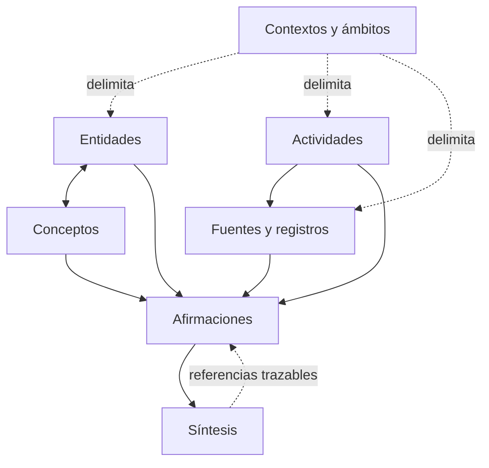

# Modelo conceptual del conocimiento de Softly

- **Estado:** diseño conceptual inicial
- **Etapa:** 1 — mapa conceptual y límites del dominio
- **Fecha:** 2026-11-13
- **Relacionado con:** `docs/architecture/knowledge-architecture.md`; `SYN-20261113-001`, secciones 16 y 17
- **Alcance:** define las familias de información que Softly debe poder representar. No fija todavía campos, identificadores, tecnología, almacenamiento ni contratos de API.

## 1. Objetivo

Softly debe representar conocimiento de dominios diversos sin convertirse en una base de datos especializada en agentes. Agentes, videojuegos, experimentos científicos, productos, organizaciones y sistemas tecnológicos deben poder describirse mediante un núcleo conceptual común.

El modelo distingue tres cosas que no deben confundirse:

1. **Aquello de lo que hablamos:** entidades y conceptos.
2. **Lo que sostenemos acerca de ello:** afirmaciones.
3. **Por qué lo sostenemos:** fuentes y registros que aportan evidencia.

Las síntesis organizan y condensan afirmaciones para una tarea o pregunta, pero no sustituyen la evidencia original.

## 2. Mapa de familias conceptuales

### 2.1 Entidades

Objetos identificables, concretos o abstractos, sobre los que se puede hablar y mantener conocimiento.

Ejemplos: un agente, una persona, un proyecto, una organización, un videojuego, un modelo, una herramienta, un sistema o un experimento particular.

Una entidad es una instancia identificable. No es su categoría ni una afirmación acerca de ella.

### 2.2 Conceptos

Categorías, ideas, propiedades o definiciones que permiten organizar e interpretar entidades y afirmaciones.

Ejemplos: autonomía, memoria episódica, coordinación, latencia, seguridad, dificultad, narrativa emergente.

Un concepto puede tener definiciones, sinónimos, relaciones jerárquicas o controversias. No debe confundirse con una instancia concreta: “memoria” es un concepto; “la memoria de TITAN” puede referirse a una entidad o componente particular.

### 2.3 Fuentes y registros

Artefactos originales o capturas verificables de los que se obtiene información.

Ejemplos: documentos, publicaciones, repositorios, mensajes autorizados, eventos, trazas instrumentadas, mediciones, imágenes, resultados y archivos.

La familia comprende tanto referencias a fuentes externas como registros generados dentro de un proyecto. Debe preservarse la distinción entre el artefacto original y los metadatos o extractos derivados para facilitar su búsqueda.

Una fuente no es automáticamente verdadera ni confiable: su autoridad, integridad, actualidad y limitaciones deben evaluarse.

### 2.4 Afirmaciones

Proposiciones delimitadas acerca de una o más entidades, conceptos, actividades o relaciones.

Ejemplos:
- “El agente A utiliza memoria externa”.
- “La latencia mediana observada fue de 240 ms”.
- “La hipótesis H explica el fallo bajo estas condiciones”.
- “Se decidió mantener separados los universos DEVAGENTS y TITAN”.

Las afirmaciones deben distinguir su naturaleza epistemológica. Taxonomía inicial:
- **FACT:** afirmación respaldada directamente por evidencia verificable.
- **OBSERVATION:** descripción de algo observado en un contexto o ejecución.
- **INFERENCE:** conclusión derivada de otras afirmaciones o evidencias.
- **HYPOTHESIS:** explicación provisional que requiere prueba.
- **RESULT:** resultado registrado de una actividad o experimento.
- **DECISION:** elección adoptada, con alcance y rationale.
- **RECOMMENDATION:** propuesta todavía no adoptada.

Una afirmación puede tener evidencia favorable, contradictoria, matizada o insuficiente. Su tipo no equivale a su nivel de confianza ni a su estado de revisión; esas dimensiones se especificarán en la etapa de datos.

### 2.5 Síntesis

Representaciones condensadas y orientadas a una pregunta, tarea, tema o dominio. Agrupan afirmaciones relacionadas y explicitan cobertura, límites, incertidumbre y vigencia.

Ejemplos: síntesis de una investigación, estado de un proyecto, perfil técnico de un agente, revisión de evidencia sobre una arquitectura.

Una síntesis es un artefacto derivado y versionable. Debe permitir navegar hacia las afirmaciones que la componen y, desde ellas, hacia sus fuentes. No es una fuente primaria ni debe borrar desacuerdos para aparentar consenso.

### 2.6 Actividades

Procesos delimitados que consumen información y pueden producir nuevos registros, afirmaciones o síntesis.

Ejemplos: investigación, experimento, evaluación, auditoría, tarea de desarrollo, revisión o sesión de observación.

Esta familia permite responder qué se intentó, con qué objetivo y condiciones, qué entradas se utilizaron y qué resultados se obtuvieron. Diseñar una actividad no significa que se haya ejecutado; esa diferencia debe quedar explícita.

### 2.7 Contextos y ámbitos

Marcos que delimitan el significado y la validez de la información.

Ejemplos: universo Softly, DEVAGENTS o TITAN; proyecto; entorno de ejecución; periodo temporal; versión de un sistema; condiciones experimentales; finalidad de uso y ámbito de autorización.

El contexto no es decoración. Una afirmación puede ser válida en un entorno y no en otro. El universo y los permisos deben acompañar la recuperación y no inferirse solo por el tema o el nombre de un objeto.

## 3. Relaciones entre las familias

El modelo debe permitir, como mínimo, expresar que:

- una afirmación se refiere a entidades o conceptos;
- una afirmación está sustentada, contradicha o matizada por fuentes y registros;
- una síntesis reúne afirmaciones y responde a una pregunta o ámbito;
- una actividad utiliza fuentes, produce registros y puede originar afirmaciones o resultados;
- una entidad participa en actividades y se relaciona con otras entidades;
- una entidad puede ser clasificada mediante conceptos;
- todos los elementos relevantes se sitúan en uno o más contextos autorizados.

Las relaciones deben poder identificarse y describirse explícitamente. No se presupone todavía si se almacenarán como tablas, documentos, enlaces, grafo u otra representación.

## 4. Vista general

El diagrama representa relaciones conceptuales, no un flujo obligatorio ni una arquitectura de ejecución. Las afirmaciones pueden originarse en distintas actividades y fuentes; una síntesis puede combinar evidencia de múltiples orígenes, siempre que respete contexto y permisos.

## 5. Dimensiones transversales

Las siguientes preocupaciones atraviesan varias familias y no se consideran entidades independientes por ahora:

- **Identidad:** distinguir registros y objetos sin colisiones.
- **Procedencia:** saber de dónde viene la información y cómo fue incorporada.
- **Tiempo y vigencia:** distinguir cuándo ocurrió algo, cuándo se registró y durante qué periodo aplica.
- **Versionado:** conservar cambios y poder reconstruir estados anteriores.
- **Confianza y evaluación:** registrar autoridad, método, cobertura, incertidumbre y revisión.
- **Acceso y retención:** aplicar permisos, sensibilidad, finalidad y ciclo de vida.
- **Integridad:** detectar alteraciones o referencias rotas cuando corresponda.

La etapa 2 decidirá cómo se expresan estas dimensiones mediante campos y metadatos.

## 6. Límites y decisiones aplazadas

Este mapa no decide todavía:

- el esquema físico ni el motor de almacenamiento;
- identificadores y convenciones de nombres;
- campos obligatorios u opcionales;
- cardinalidades y restricciones formales;
- formato de relaciones y referencias;
- estrategia de indexación o recuperación;
- política completa de retención y eliminación;
- automatización de captura, extracción o síntesis.

Tampoco declara que Softly ya capture, almacene, indexe o recupere estos elementos. Es un diseño conceptual pendiente de especificación y evaluación.

## 7. Criterios para considerar útil el modelo

El mapa conceptual será adecuado si permite:

1. representar dominios distintos sin crear una estructura especial para cada uno;
2. separar objetos, categorías, afirmaciones y evidencia;
3. conservar contradicciones e incertidumbre sin forzar consenso;
4. reconstruir la procedencia de una afirmación incluida en una síntesis;
5. situar la información en su universo y contexto;
6. describir actividades propuestas y ejecutadas sin confundirlas;
7. incorporar nuevas familias mediante extensión controlada, sin romper el núcleo.

## 8. Resultado de la etapa y siguiente paso

**Resultado:** siete familias conceptuales iniciales —entidades, conceptos, fuentes y registros, afirmaciones, síntesis, actividades y contextos— más un conjunto de dimensiones transversales.

**Pendiente de revisión:** validar si estas familias cubren los casos representativos de Softly y si alguna debe dividirse o combinarse.

**Siguiente etapa:** especificar identificadores y campos mínimos para cada familia, junto con ejemplos de registros y reglas iniciales de procedencia. La selección tecnológica seguirá aplazada.

## 9. Desarrollo de la etapa 2

La especificación inicial de identificadores y campos mínimos está en [Especificación inicial del modelo de datos de conocimiento](knowledge-data-model-v0.1.md). Es una propuesta lógica v0.1, neutral respecto de la tecnología y pendiente de validación. Distingue identidad estable, versión del registro, procedencia, contexto y política de acceso.
